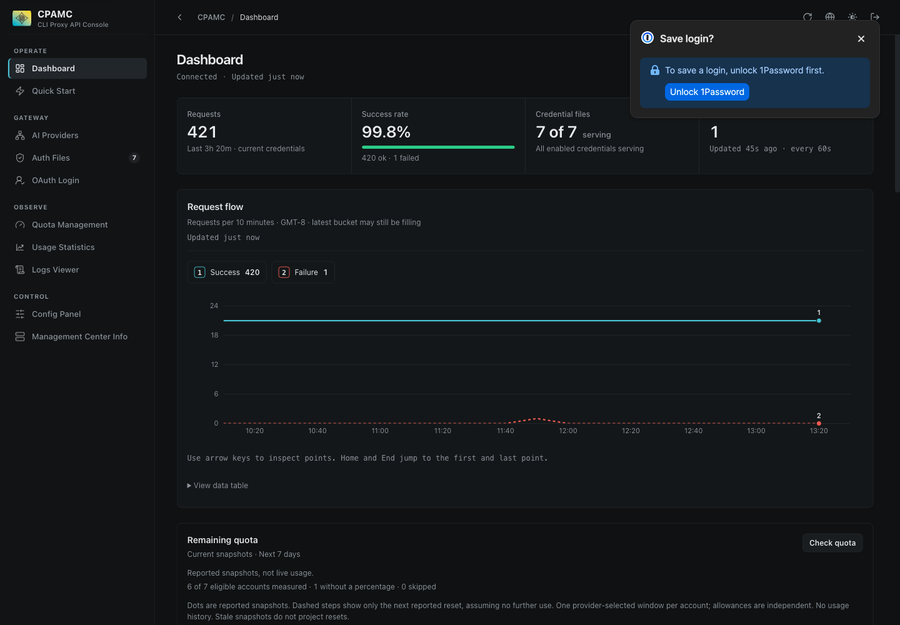
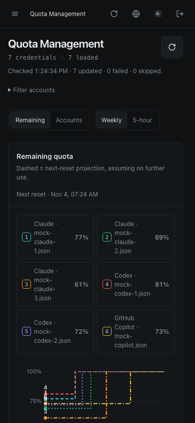

# Management workspace redesign

The redesign keeps the existing management API, provider controls, plugin trust gates, hash routes, and single-file deployment. Healthy dashboards show no attention card. Incidents and initial provider setup remain actionable.

## Review fixes

- One per-credential request owner coalesces batch and individual observations. Session, file, and operation ownership checks reject superseded results without replacing accepted values or timestamps.
- Automatic xAI checks only observe billing data. Inference health tests require a separate action whose translated label warns about charges.
- Snapshot-backed refreshes reload auth files before reading usage. Failed reads retain stale snapshots without advancing successful timestamps.
- Quota projections keep independent sparse series. Tests cover 500 accounts using 2,000 samples. This is a data-size bound, not a browser-latency claim.
- The existing account breakdown supplies accessible quota evidence. Other chart tables mount only when opened. Keyboard inspection and numbered series remain available.
- Product tests use isolated instances of shipped locale bundles. Missing-key and interpolation tests do not depend on design-review artifacts. Meta and Copilot window labels are translated.
- OAuth editors share the feature-owned shell stylesheet while retaining separate body styles.

## Verification

Pinned Bun 1.3.14. Full tests, ESLint, TypeScript, and production single-file build passed. Frozen dependency installation passed with default registry resolution and unchanged package integrity values.

Existing-profile Chrome checks covered Dashboard, Auth Files, both OAuth editors, Quota, and Usage at 1440 × 1000 and 390 × 844. Local synthetic fixtures verified native chart keyboard navigation, series focus, request-free filter/search/window changes, cached refreshes with partial failures, route re-entry checks, and live/off/unknown/error/stale Usage states. No real credentials or inference calls were used for these checks.

These review fixes have not been redeployed to Railway. The previously deployed redesign predates them. Backend configuration and credentials are outside this PR.

## Screenshots

Both images use synthetic local fixtures. No prototype data is bundled into the production application.

